# Filenest

**Your files, safely nested.** Filenest is a full-stack cloud drive: upload files with live progress, organise them in nested folders, preview almost anything in the browser, and share public links you control (view-only or downloadable, with an expiry you can change or revoke at any time).

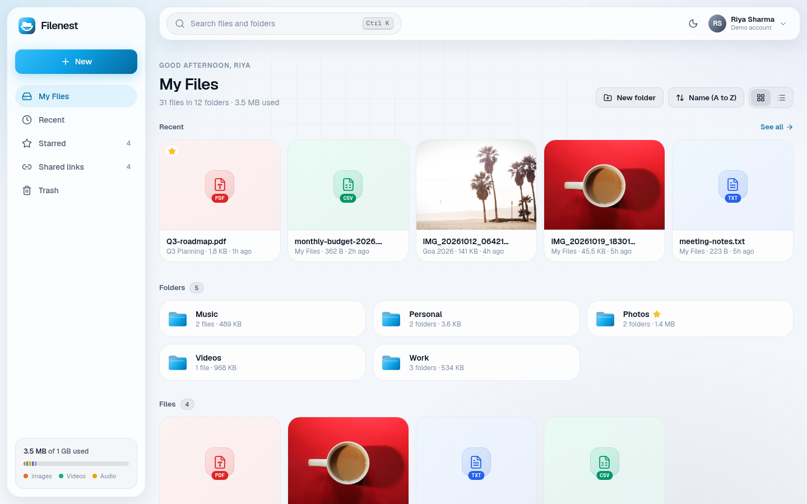

## What's new in 2.0

Filenest 2.0 is a full redesign and hardening of a basic course project ("Drivea").

| Area | 1.0 | 2.0 |
|---|---|---|
| Design | Plain light pages, orange accent | "Skyline" design system: glass panels, aurora background, Geist, light by default with a dark mode toggle, phone layout with a tab bar |
| Uploads | One request with a simulated progress bar | Real per-file progress, three at a time, cancel and retry, drop files anywhere, warning before closing mid-upload |
| Finding things | Search box for the current folder | ⌘K search across all files and folders, Recent (uploaded, edited or opened), Starred |
| Preview | Modal with image / video / audio / PDF | Full-screen viewer with previous/next and swipe; text, CSV tables, JSON and rendered Markdown; details panel with location, dates and link status |
| Sharing | Link that could only be revoked | View-only or downloadable links, expiry (1, 7 or 30 days, or never), open counts, a Shared links page, browsable shared folders |
| Trash | Every file inside a deleted folder listed one by one | Items as you deleted them, folder contents counted, Undo right after deleting, restores that never leave items hidden |
| Settings | None | Profile, password, theme and storage insights (by category and a 14-day upload chart) |
| Security | Owner checks on most queries | Owner email no longer leaked on public links, no raw database errors to clients, atomic storage quota, rate limits, helmet, 74 automated checks |
| Running it | Needed a Neon database and an S3 bucket | `npm run services` starts Postgres and an S3-compatible server in Docker; Neon and Cloudflare R2 still work |

## Features

- **Accounts**: sign up and log in with an httpOnly cookie session, password show/hide, one-click demo account
- **My Files**: nested folders with item counts and sizes, file cards with image thumbnails, grid or list view, six sort orders, breadcrumbs
- **Uploads**: drag and drop anywhere, upload panel with per-file progress, cancel and retry, storage quota per account (1 GB by default)
- **Actions** from the ⋯ menu, a right-click or the viewer: preview, download, share, star, rename, move (folder tree picker), new folder inside, move to Trash with Undo
- **Search**: ⌘K / Ctrl+K or `/` opens a palette that searches every file and folder name, with quick actions when empty
- **Recent and Starred**: recent activity grouped by day, starred items with their location
- **Preview**: images (fit or actual size), video, audio, PDF, plain text with line numbers, CSV as a table, pretty JSON, rendered Markdown with a source view
- **Public links**: anyone with the link can open a file or browse a shared folder without an account; downloads only when allowed; expired and revoked links get a friendly page
- **Shared links page**: every link with its permission, expiry state and open count; copy, open, change settings, revoke
- **Trash**: restore, delete forever, empty the Trash, with confirmations
- **Settings**: display name, password, theme, storage by category, uploads over the last 14 days
- **Polish**: loading skeletons, empty and error states, toasts, keyboard support, `prefers-reduced-motion`, aria labels, layouts from 390px phones to wide desktops

## Screenshots

| | |
|---|---|
| 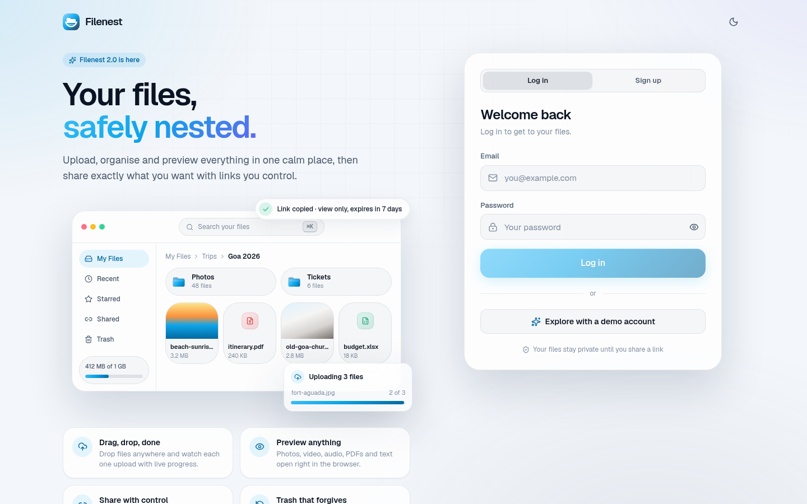 | 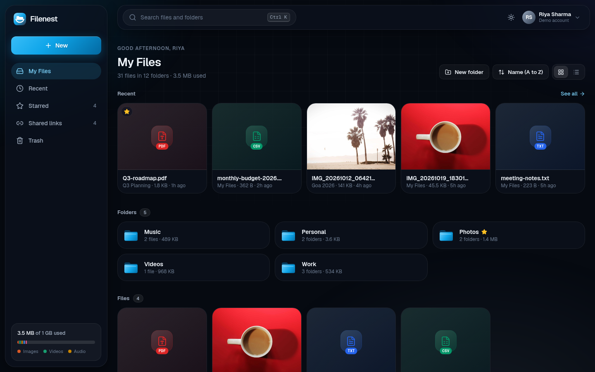 |
| Sign in with a live product preview | My Files, dark mode |
| 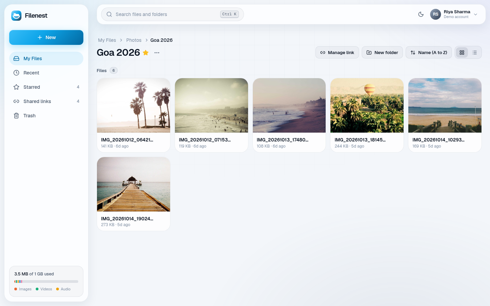 | 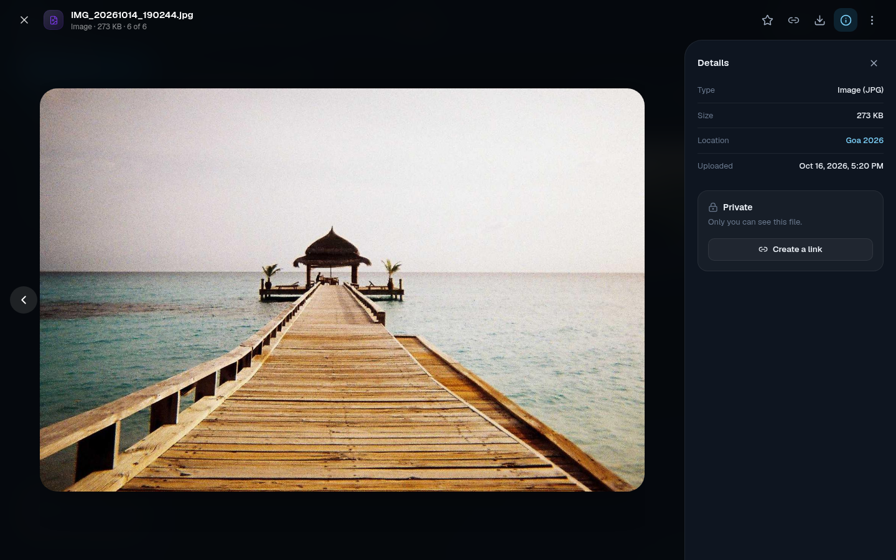 |
| A folder with photo thumbnails | Full-screen viewer with details |
| 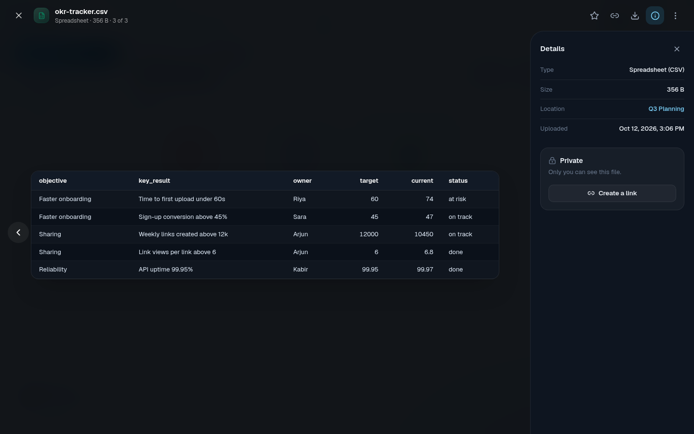 | 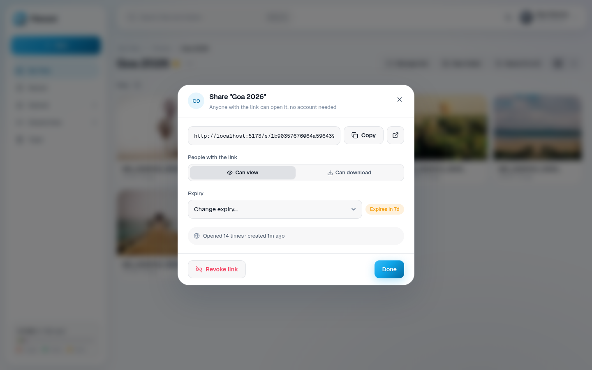 |
| CSV opens as a table | Link permissions and expiry |
| 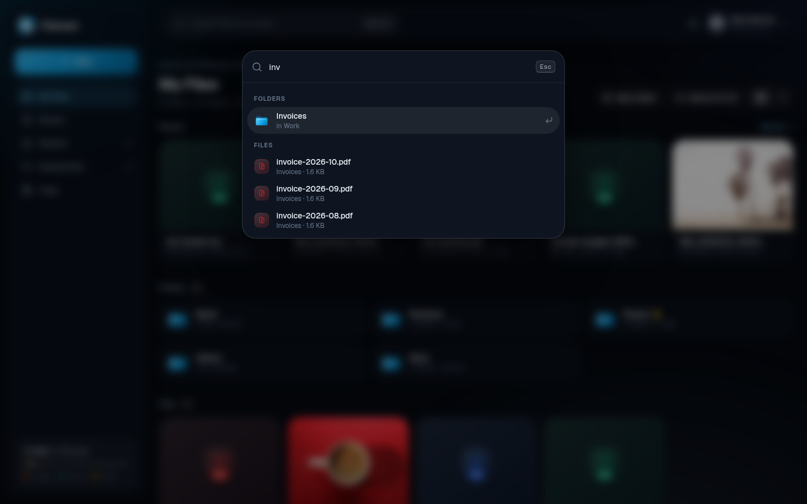 | 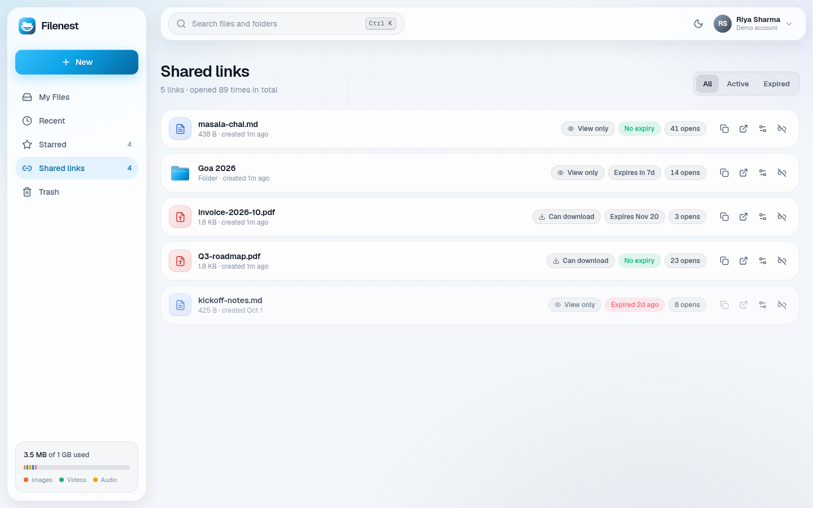 |
| ⌘K search | Every public link in one place |
| 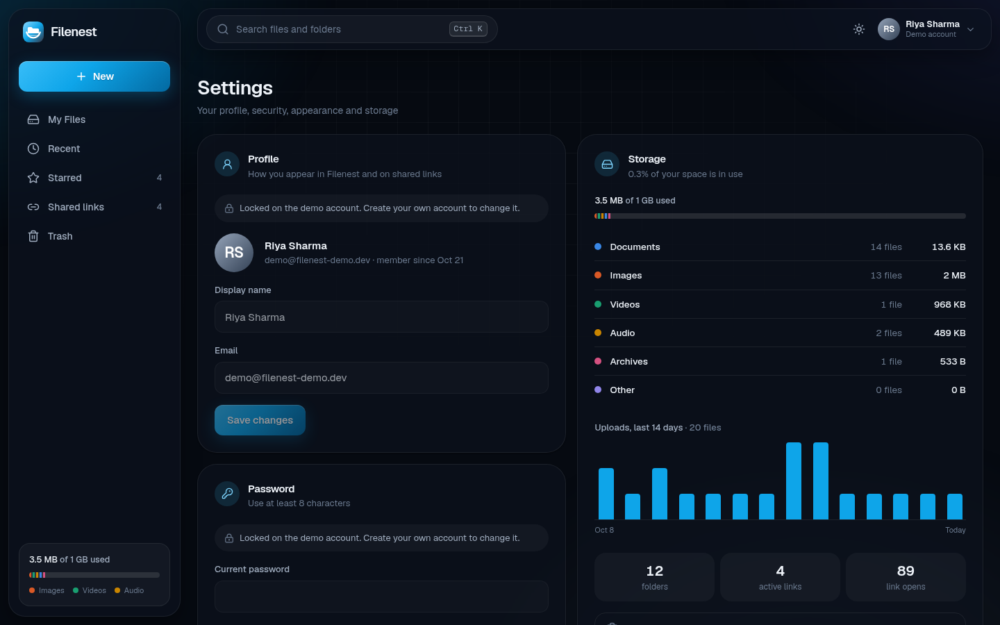 | 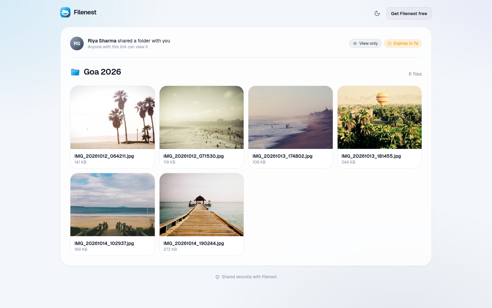 |
| Storage insights | What someone with the link sees |

<p>
  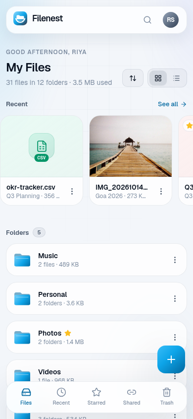
  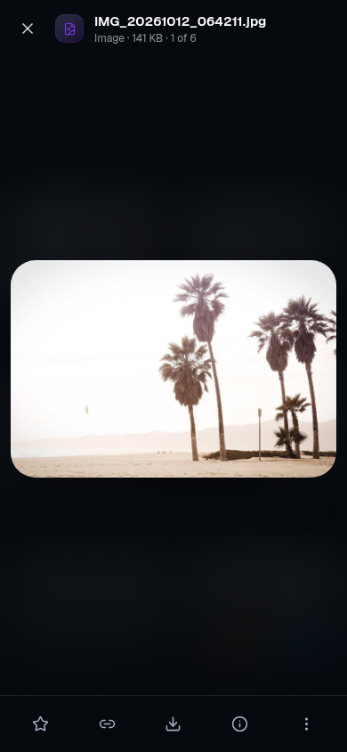
</p>

## Tech stack

| Part | Tech |
|---|---|
| Client | React 19, Vite 8, Tailwind CSS 4, React Router 7, Axios, lucide-react, react-hot-toast |
| API | Node.js, Express 5, JWT in an httpOnly cookie, Multer, helmet, express-rate-limit |
| Database | Postgres: Neon (serverless driver) in production, plain Postgres locally (node-postgres) |
| File storage | Any S3-compatible bucket via AWS SDK v3 with presigned URLs: Cloudflare R2, AWS S3, or RustFS locally |
| Tooling | oxlint, nodemon, concurrently, Docker Compose for local services |

## Project structure

```
filenest/
├── client/                      # React app
│   ├── src/
│   │   ├── pages/               # Auth, Drive (My Files + folders), Recent, Starred, Shared, Trash, Settings, SharedLink, NotFound
│   │   ├── components/
│   │   │   ├── ui/              # Logo, Avatar, Modal, Menu, ConfirmDialog, EmptyState, FileGlyph, ThemeToggle, AppToaster
│   │   │   ├── layout/          # AppLayout, Sidebar, Topbar, MobileNav, CommandPalette, StorageMeter
│   │   │   ├── drive/           # cards and rows, upload panel, drop overlay, move / share / name dialogs
│   │   │   ├── preview/         # FileViewer, PreviewBody (image, video, audio, PDF, text, CSV, Markdown), FilePreview
│   │   │   └── auth/            # route guard, animated product preview
│   │   ├── context/             # Auth, Uploads, Actions (every item action + dialogs), Workspace
│   │   ├── hooks/ lib/          # data loading, theme, formatting, file kinds, share helpers
│   │   └── index.css            # design tokens and primitives
│   └── vercel.json              # SPA rewrites
├── server/                      # Express API
│   ├── controllers/             # auth, files, folders, drive (recent, starred, search, stats), shares, trash
│   ├── routes/ middleware/      # auth guard, uploads, rate limits
│   ├── services/ utils/         # folder hierarchy, storage helpers, request helpers
│   ├── config/                  # Postgres / Neon connection and schema, S3 client
│   └── scripts/                 # seed.mjs, sample-files.mjs, security-test.mjs, create-bucket.mjs
├── docker-compose.dev.yml       # local Postgres + S3 (RustFS)
├── docs/screenshots/
└── package.json                 # run everything from the root
```

## Getting started

### Prerequisites

- Node.js 20+
- Either **Docker** (runs Postgres and an S3-compatible server locally, no accounts needed)
- Or a [Neon](https://console.neon.tech) Postgres database and an S3-compatible bucket ([Cloudflare R2](https://dash.cloudflare.com) has a free tier)

### 1. Clone and install

```bash
git clone https://github.com/Yusuf-Hussain25/filenest.git
cd filenest
npm install && npm run install:all
```

### 2. Configure `.env`

```bash
cp server/.env.example server/.env
cp client/.env.example client/.env
```

| File | Key | Where to find it |
|---|---|---|
| `server/.env` | `JWT_SECRET` | Any long random string: `openssl rand -hex 32` (the server refuses to start without 32+ characters) |
| `server/.env` | `DATABASE_URL` | Local default works with `npm run services`; for Neon: your project → **Connect** → connection string |
| `server/.env` | `AWS_ENDPOINT_URL_S3`, `AWS_ACCESS_KEY_ID`, `AWS_SECRET_ACCESS_KEY`, `AWS_REGION`, `AWS_S3_BUCKET` | Local defaults work; for R2: **R2 → Manage API tokens → Create API token** (Object Read & Write) |
| `server/.env` | `ORIGINS` | Browser origins allowed to call the API (`http://localhost:5173`) |
| `server/.env` | `MAX_FILE_SIZE`, `MAX_STORAGE_PER_USER` | Optional limits in bytes (100 MB per file, 1 GB per account) |
| `server/.env` | `DEMO_EMAIL`, `DEMO_PASSWORD`, `SEED_PASSWORD` | Your choice; used by `npm run seed` and the demo button |
| `client/.env` | `VITE_BASE_URL` | URL of the API (`http://localhost:3000`) |
| `client/.env` | `VITE_DEMO_EMAIL` | Optional. Shows "Explore with a demo account" |

If `VITE_BASE_URL` is missing, the app shows a setup screen naming the key instead of a blank page.

### 3. Run

```bash
npm run services   # Docker: Postgres on :5435 + S3 (RustFS) on :9000, creates the bucket
npm run dev        # API on http://localhost:3000 + web app on http://localhost:5173
npm run seed       # optional: demo data (see below)
```

The API creates and upgrades its tables on start (additive `ADD COLUMN IF NOT EXISTS` migrations).

### 4. Security checks

With the API running, `npm run test:security` creates two throwaway accounts and runs 74 checks: logged-out visitors are refused, users can only reach their own files, folders, links, stars, stats and trash, malformed input gets clean errors, public links expose only what they should (no owner email, ids or storage keys; view-only links have no download URL; shared folders can't be used to reach files outside them), and storage quotas hold. Everything it creates is deleted at the end.

## Configurable providers

| What | Local (default) | Production |
|---|---|---|
| Database | Plain Postgres in Docker, used through node-postgres | Neon: any `DATABASE_URL` containing `neon.tech` uses Neon's serverless driver |
| File storage | RustFS (S3-compatible) in Docker | Cloudflare R2, AWS S3 or any S3-compatible service: just change the `AWS_*` values |

Both are switched by `.env` alone. `config/db.js` gives node-postgres the same tagged-template `sql`, `sql.unsafe` and `sql.transaction` API as Neon, so no query code changes. Files are served through short-lived presigned URLs, so the bucket stays private and needs no CORS setup.

## Demo data

Set `DEMO_EMAIL`, `DEMO_PASSWORD` and `SEED_PASSWORD` in `server/.env`, start the API, then:

```bash
npm run seed                          # demo account + two other accounts
npm run seed -- --with you@email.com  # also give your own account the demo drive
npm run seed -- --reset               # delete the demo accounts and start fresh
```

The seeder goes through the same API as the app. It creates **Riya Sharma** (`demo@filenest-demo.dev`) with 31 files in 12 folders: work documents and invoices, Goa trip and family photos ([picsum.photos](https://picsum.photos)), recipes in Markdown, CSV and JSON, a ZIP archive, two short melodies and a video clip (Big Buck Bunny, © Blender Foundation, CC BY 3.0). PDFs, audio and archives are generated in code. It also stars items, creates five public links (one expired) with view counts, and puts a few items in the Trash. Upload times are spread over the last 30 days. Re-running it reuses what exists.

Set `VITE_DEMO_EMAIL` in `client/.env` to show "Explore with a demo account". The server signs the visitor in, so no password ships to the browser, and the demo account's profile and password are read-only.

## Deployment

**Database and storage:** create a Neon database and an R2 bucket (or S3), and put their values in the API's environment.

**API (Render, free web service):** uploads go up to 100 MB, beyond the 4.5 MB request limit of serverless functions, so the API runs as a normal Node service.
1. Render → **New → Web Service** → connect the GitHub repo
2. Root directory `server`, build command `npm install`, start command `npm start`
3. Environment: everything from `server/.env`, plus `NODE_ENV=production` (secure, cross-site cookies) and `ORIGINS=https://<your-app>.vercel.app`

**Client (Vercel):**
1. Vercel → **Add New → Project** → import the repo, root directory `client` (Vite is detected)
2. Environment variables: `VITE_BASE_URL=https://<your-api>.onrender.com` and optionally `VITE_DEMO_EMAIL`
3. `client/vercel.json` already rewrites every path to `index.html`, so `/folder/:id` and `/s/:token` links work

Safari blocks third-party cookies, so if the API and app are on different domains, proxy the API through Vercel: add `{ "source": "/api/(.*)", "destination": "https://<your-api>.onrender.com/api/$1" }` before the SPA rewrite in `client/vercel.json`, set `VITE_BASE_URL=/`, and use the Vercel URL in `ORIGINS`.

## Author

**Yusuf Hussain** · [github.com/Yusuf-Hussain25](https://github.com/Yusuf-Hussain25)
